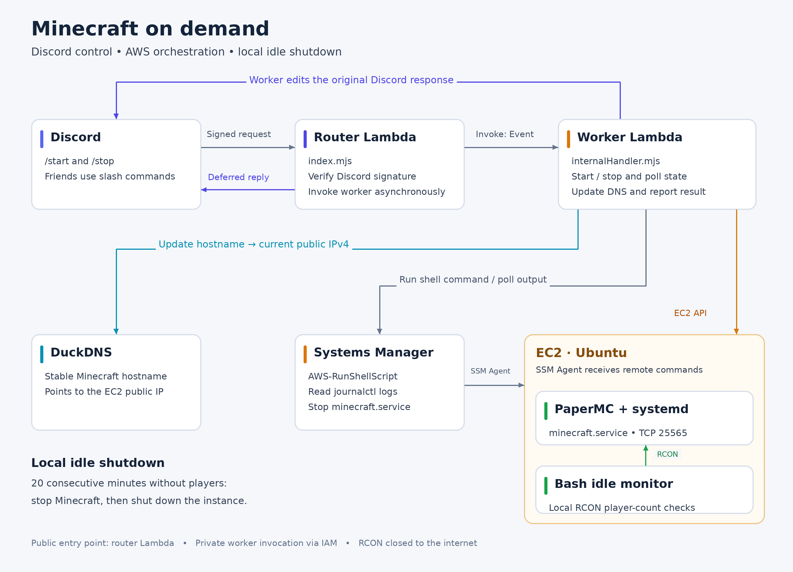

# minecraftServer
Hello thanks for checking out my server repo. It includes parts of an on-demand Minecraft server hosted on AWS EC2 and controlled through Discord. Friends can start and stop the server with slash commands, without needing access to AWS or SSH.

Internally, the Discord bot sends requests to a public-facing AWS Lambda function, which verifies that the request is from Discord, calls the internal start up/shutdown Lambda function asynchronously, and returns an acknowledgement so Discord doesn't time out.

The start up function starts the server, updates the DuckDNS hostname (because I don't want to pay 3$ a month for an Elastic IP), and updates the Discord bot once the PaperMC server is up and running.

I think it saves me ~18$ a month on hosting? It utilizes 8GB of RAM which normally costs 20+ USD on most hosting sites. 

**Note** Deployment requires your own AWS resources, Discord application, and DuckDNS account. The idle-monitor script and systemd service files are configured separately on EC2 and are not currently included in this repository.

## **Features**
- **Discord commands**: `/start` starts the server, and `/stop` stops Minecraft before requesting EC2 to stop.
- **Start up checks** :Polls EC2 state and reads Paper's start up logs through AWS Systems Manager before reporting that Minecraft is ready.
- **Dynamic DNS**: Updates DuckDNS with the instance's public IPv4 address.
- **Discord status updates**: Replaces deferred response with success or failure message
- **Automatic idle shutdown**: The EC2 instance itself uses a RCON client to monitor the number of active players in the servers, shutting itself down after 20 consecutive minutes with no players.
- **Security Management**: AWS Identity and Access Management (IAM) roles control which AWS resources each Lambda function and the EC2 instance can access.

## **Guide**
- `discordBot` contains the utility functions and commands used by the Discord bot.
- `index.mjs` contains the code for the public-facing Lambda function.
- `internalHandler.mjs` contains code for the internal Lambda function handling server control.

## Architecture
Special thanks to ChatGPT for drawing my picture for me

